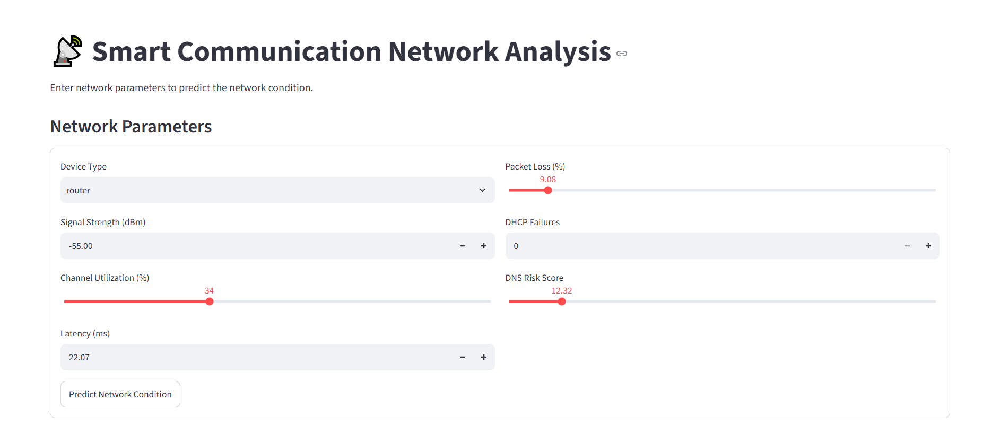

# Smart Communication Network Analysis and Prediction Using Machine Learning

## 📌 Project Overview

Smart Communication Network Analysis and Prediction is a machine learning-based web application designed to analyze communication network parameters and predict network conditions.

The system uses a **Random Forest Classifier** to identify potential network issues based on parameters such as signal strength, channel utilization, latency, packet loss, DHCP failures, DNS risk score, and device type.

The application is developed using Python and Streamlit, providing an interactive interface for network condition prediction and probability analysis.

## 🚀 Live Application

Try the application here:

[Open Smart Communication Network Analysis](https://smart-communication-network-analysis.streamlit.app/)

## 🎯 Objectives

- Analyze key communication network parameters.
- Identify different types of network issues.
- Predict network conditions using machine learning.
- Provide an interactive and user-friendly web interface.
- Display prediction results along with probability scores.

## 📊 Dataset Information

**Dataset Name:** SmartNet Network Incidents  
**Source:** Hugging Face

**Dataset Link:** [SmartNet Network Incidents](https://huggingface.co/datasets/codingkiddo/smartnet-network-incidents)

| Dataset Details | Information |
|---|---|
| Total Records | 4,200 |
| Total Columns | 11 |
| Prediction Classes | 6 |

**Note:** The dataset is synthetic and intended for academic and educational purposes. Model performance on this dataset does not establish accuracy or reliability on real-world network traffic.

## ⚙️ Input Features

The model uses the following seven input features:

1. RSSI (Signal Strength)
2. Channel Utilization (%)
3. Latency (ms)
4. Packet Loss (%)
5. DHCP Failures
6. DNS Risk Score
7. Device Type

## 🔍 Predicted Network Conditions

The classification model identifies six network conditions:

| Class | Description |
|---|---|
| Healthy | Normal network condition |
| Weak Signal | Low wireless signal strength |
| High Latency | Higher network response delay |
| Wi-Fi Congestion | High channel utilization |
| DHCP Failure | Issues in IP address allocation |
| DNS Security Risk | Potential DNS-related security risk |

## 🛠️ Technologies and Libraries

| Technology | Purpose |
|---|---|
| Python | Core programming language |
| Pandas | Data manipulation |
| NumPy | Numerical operations |
| Scikit-learn | Machine learning model |
| Streamlit | Web application development |
| Joblib | Model serialization |
| Jupyter Notebook | Data analysis and model development |

## 🤖 Machine Learning Approach

**Algorithm:** Random Forest Classifier

The project follows a machine learning workflow:

1. Dataset loading and exploration.
2. Data preprocessing and feature preparation.
3. Encoding categorical features.
4. Splitting the dataset into training and testing sets (80:20).
5. Training the Random Forest Classifier.
6. Evaluating model performance.
7. Saving the trained model using Joblib.
8. Integrating the model into a Streamlit application.

## 📈 Model Performance

The trained Random Forest Classifier achieved:

**Test Accuracy: 99.88%**

The model was evaluated using an 80:20 stratified train-test split.

**Important:** This accuracy represents performance on a held-out portion of the synthetic dataset. It should not be interpreted as validated real-world network prediction accuracy.
**Note:** Model probability scores represent the classifier's estimated probabilities and do not guarantee prediction correctness.

## 💻 Web Application Features

The Streamlit application allows users to:

- Enter network parameters through an interactive interface.
- Select the device type.
- Predict the current network condition based on entered values.
- View the predicted network category.
- View prediction probability scores.

## 📁 Project Structure

```text
Smart-Communication-Network-Analysis/
│
├── app.py
├── network_analysis.ipynb
├── network_model.pkl
├── requirements.txt
├── Dashboard.PNG
├── prediction result.PNG
└── README.md
```

## 🚀 Installation and Execution

**Step 1: Clone the repository**

```bash
git clone https://github.com/sejalpatil0211/Smart-Communication-Network-Analysis.git
```

**Step 2: Navigate to the project directory**

```bash
cd Smart-Communication-Network-Analysis
```

**Step 3: Install dependencies**

```bash
pip install -r requirements.txt
```

**Step 4: Run the Streamlit application**

```bash
streamlit run app.py
```

## 🔮 Future Scope

- Integration with real-time network monitoring systems.
- Evaluation using real-world network datasets.
- Improving model generalization and reliability.
- Adding network performance visualization dashboards.
- Developing automated network issue detection.
- Integration with real-time network traffic monitoring and alert systems.

## 👩‍💻 Author

**Sejal Patil**

Third Year Electronics and Telecommunication Engineering Student

**Project:** Smart Communication Network Analysis and Prediction Using Machine Learning

## 📸 Application Screenshots

### 1. Main Dashboard


### 2. Prediction Result

